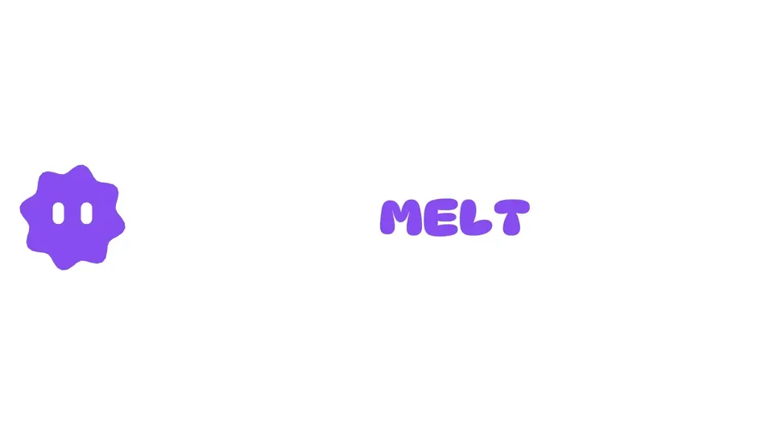
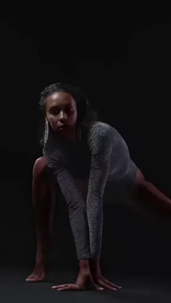
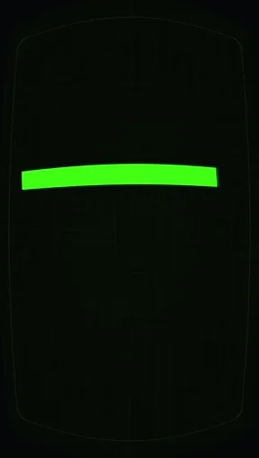
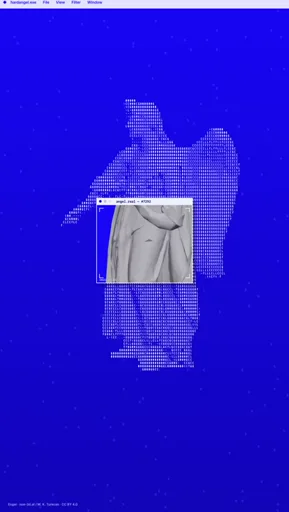

  

<h1 align="center">Design that melts social feeds.</h1>

  <strong>Images. Video. Type. 3D. Motion.</strong> 
  A free, open-source creative studio in your browser.

  

  No account. Your projects stay with you.

  

Made in Melt. The letters are still editable. <a href="apps/web/public/videos/landing/morphing-type/preview-c84f0e1119f4.webm">Watch the loop →</a>

Make a poster. Push it into motion. Export the reel — and the timelapse of how you made it.

Melt gives you a canvas for mixing photos, video, typography, shapes and 3D. Start with a template, replace the media, bend the type and build your own look. Effects preview as you work. Every layer stays yours to change.

[Start creating](https://melt.plinka.eu/) · [See what you can make](#made-in-melt) · [Explore the features](#effects-in-real-time) · [Get involved](#make-it-with-us)

## Made in Melt

These are editable templates made with the same tools you get in the editor. Open a preview, then make the design your own.

<table>
  <tr>
    <td align="center" width="33%">
       
      <strong>Second Skin</strong> 
      Footage. Thermal color. Moving type.
    </td>
    <td align="center" width="33%">
       
      <strong>Terminal Signal</strong> 
      A terminal with a pulse.
    </td>
    <td align="center" width="33%">
       
      <strong>Angel.exe</strong> 
      3D meets desktop chaos.
    </td>
  </tr>
</table>

There’s more to remix: chrome typography and reflections in **Cornell Box**, flower timelapses in **Bloom Windows**, the **Melt Mascot**, and animated photo collages. Templates contain real layers, effects and animation you can edit.

## Effects in real time.

Explore **40+ effects and color adjustments**. Drag a slider, move an effect across the canvas or paint a distortion. Watch the look change while you work.

- **Give it a look.** Halftone dots, circular color grids, dithering, ASCII, grain, cyanotype, thermal palettes, CRT, digital glitches, pink phosphor and printed-receipt treatments. Stack effects and keep adjusting them.
- **Get hands-on.** Push, pinch, inflate and twist with a round **Liquify** brush. Build torn-paper edges, displaced fragments, ink bleed and pixel-sorted streaks.
- **Make blur do more.** Gaussian, box, directional, spin, zoom, lens and edge-preserving blur, with controls for each technique. Keep an area sharp with a movable, feathered protection circle.
- **Find your color.** Adjust exposure, contrast, hue, saturation, temperature and gradients. Blend layers, add shadows and keep the original media intact.

## One canvas. Every ingredient.

Bring photos, video, text, shapes and 3D into the same design.

**Type that has a personality.** Explore 1,950 Google Fonts families, use bundled fonts or bring your own. Add colored outlines, gradients and crisp offset shadows. Animate letters, stretch them, inflate them and keep the words editable.

**3D you can actually play with.** Add shapes, extruded text or models from the library, or import a GLB. Adjust materials, lights, shadows, reflections and the camera. Mix 3D with your images and type, then bring it into motion.

**Room to build.** Keep multiple artboards in one project. Arrange layers and nested groups, try blend modes, align with guides and snapping, and work in phone, square, landscape or print-size formats. Bring in shapes, icons, logos and editable SVG artwork.

## Cut it out. Keep creating.

Click to select an object with local AI. Add points to include or exclude areas, draw a box, preview the outline and refine it before applying anything. The magic wand gives you color-based selection with adjustable tolerance.

Keep or erase an area, invert the selection, or turn selected pixels into a new layer. Use **masks and clipping** to fit one layer inside another’s silhouette. Your originals stay intact, and undo/redo lets you try another direction.

Familiar shortcuts help you keep moving: **Ctrl/Cmd + J** to copy into a layer, **Ctrl/Cmd + Shift + J** to cut into one. **Ctrl/Cmd + K** finds commands by name, description or shortcut, in English and your current language.

## Make it move.

Pick an animation preset, set its timing and make it yours. Stagger letters, build entrances, rotate objects, morph typography or turn a composition into a loop. Save your own motion presets and use them again in another project.

When you want more control, reach for keyframes and curves. Bring video and audio onto the timeline, adjust clips, mix sound and add fades. Static designs and motion live in the same project.

**Show the process, too.** Turn your recorded editing history into a creation timelapse. The making-of becomes another thing to share.

## Made for the laptop you already have.

Melt puts your laptop’s graphics to work for live effects and canvas navigation. It’s tested on integrated graphics, too.

- **60 FPS canvas panning** in the documented integrated-graphics test scene.
- **50 image layers and 100 effects** in a separate photographic stress test.

[See the measurements →](docs/rendering/performance-protocol.md)

## Finish it. Share it. Keep the project.

Export **PNG, JPEG or WebP** for your artwork, and **MP4 or WebM** for motion and timelapses. Export a selection, an artboard or a batch of artboards. Include audio in your motion videos.

Download an editable **`.musart` or ZIP project** with its images, video and audio. Reopen it later or take it to another device. Autosave keeps your work in this browser while you create.

Choose light or dark mode, six accent palettes and **12 interface languages** ([coverage](docs/guides/editor-localization.md)). Customize your shortcuts and pin the commands you reach for most. A guided tour helps you get from your first layers to your first export.

## Your turn.

1. [Open Melt](https://melt.plinka.eu/) and choose a template or a blank artboard.
2. Drop in your media. Change the type. Try an effect. Add some motion.
3. Export your creation, save the editable project, and share the process.

No account to make. Your projects save on your device, and image processing happens locally. Fonts and the optional object-selection model download when you choose to use them.

## Make it with us

Melt is free and open source under the [MIT License](LICENSE), built as an independent project for the [2026 Meta Global AI Developer Hackathon](https://dev.meta.ai/events/global-hackathon).

Have an idea, found a bug, or made something worth sharing? [Open an issue](https://github.com/ExtraBinoss/Melt.App/issues) or [contribute](CONTRIBUTING.md).

[User guides](docs/README.md) · [Run locally](CONTRIBUTING.md) · [Work with your agent](docs/guides/headless.md) · [What’s new](CHANGELOG.md) · [Credits](docs/legal/provenance.md) · [Third-party notices](THIRD_PARTY_NOTICES.md) · [Security](SECURITY.md)

<a href="https://melt.plinka.eu/"><strong>Start creating → melt.plinka.eu</strong></a>

