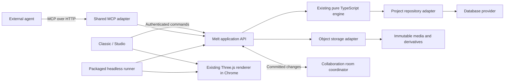

# Cloud architecture and provider boundaries

## Authority and ownership

The cloud holds the authoritative project ID, durable revision and committed
document. Classic, Studio, headless and MCP address that same identity. Selection,
viewport, open panels and temporary property previews remain presentation state.

The browser may cache data and retain pending recovery work. A local cache does
not become a separately authoritative project. Offline editing, merge behavior
and access after subscription expiration require separate policies.

The diagram describes logical responsibilities. It does not require a separate
container for every box. Initially, the application API and MCP can share a
TypeScript/Bun service with bounded request contexts and caches.

`packages/core` stays pure: no database driver, OAuth SDK, network connection,
React state or GPU resource enters portable documents. `packages/render` keeps
Three.js resources and exports. Platform code implements persistence, auth and
transport ports outside those packages.

## Database-independent persistence

Store project document data in the database through a repository abstraction,
alongside small project/account metadata. Separate immutable media into object
storage. Large historical checkpoints may use blob references behind the same
repository contract if measurement justifies it; callers must not depend on that
provider-specific representation.

The repository contract must express behaviors, not generic CRUD alone:

- Bounded project listing by owner/workspace and cursor.
- Reading a specific immutable revision and the current head.
- Committing an atomic engine transaction against an expected durable revision.
- Idempotent operation lookup and durable duplicate-request handling.
- Publishing document head, journal entry, usage deltas and event/outbox metadata
  atomically where they belong to the same persistence transaction.
- Tombstoned deletion and rejection of stale writes to retired identities.
- Bounded history pagination and retention/checkpoint operations.

Use stable portable IDs and application revisions rather than database row
positions or process-local counters. Preserve the engine's validation and existing
compare-and-swap guarantees. A revision conflict must not silently replace a
newer project with an older client snapshot.

Neon/Postgres is a candidate provider. Its connection details, SQL and limits
belong in one adapter. Another provider must be able to implement the same tested
semantics. Transaction and conditional-write requirements are capabilities that
an adapter must meet, not optional behavior hidden by an agnostic interface.

## Object-storage boundary

Expose immutable-object upload/finalization, scoped reads, metadata inspection,
reference management and deletion through a separate port. Documents store
provider-neutral asset IDs; provider URLs, bucket names and expiring download
credentials are runtime concerns.

Separate portable serialization from cloud storage records. Current embedded
originals and media contracts require an explicit cloud preparation/resolution
adapter; replacing them with URLs everywhere would break the existing format.

A database and object store do not share a transaction. Upload immutable data
first; atomically publish its references with the document commit. Failed or
abandoned uploads enter a bounded cleanup workflow. Garbage collection must
recheck live references and deletion generations before removing an object.

## Changes and process boundaries

Every committed write follows the same path: authenticate, resolve permissions
and entitlements, validate expected revision and operation identity, run the
existing engine transaction, persist atomically, then publish the durable result.
Local optimistic rendering must distinguish pending from persisted changes.

Do not let a successful transport response claim that rendering or export also
completed. Domain errors, committed revisions and asynchronous job states have
separate typed results. An outbox/reconciliation mechanism must cover a crash
between durable commit and collaboration broadcast.

MCP implementations in Rust or Go can call this API. They must not become a
second implementation of commands, Motion or effect validation. If TypeScript
executes on the server, share the runtime across users rather than launching one
interpreter or Chrome per account.

## Migration

Existing local projects continue to work until migration is delivered. Upload
originals, validate a cloud revision, read it back, verify media references and
retain recovery data before marking migration complete. Make retries idempotent.
Never delete local originals merely because an upload request was accepted.

Restore the same cloud project into both workspace modes. Keep `.musart` and ZIP
import/export compatibility. Migrating cloud ownership does not authorize
flattening effects, dropping history or altering authored Motion keys.
